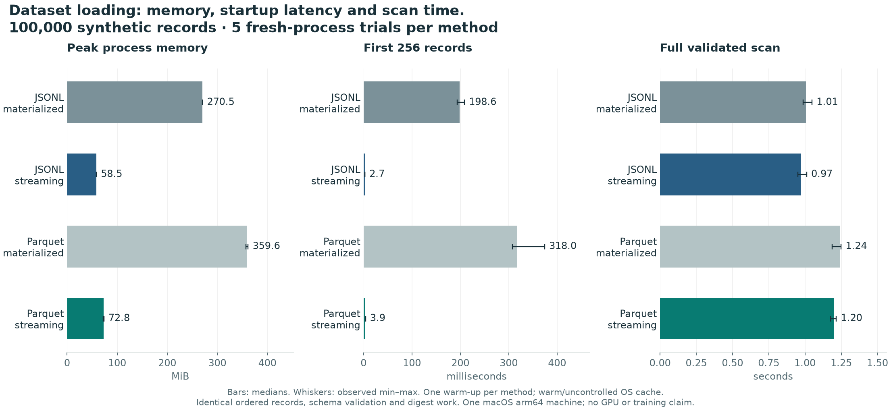
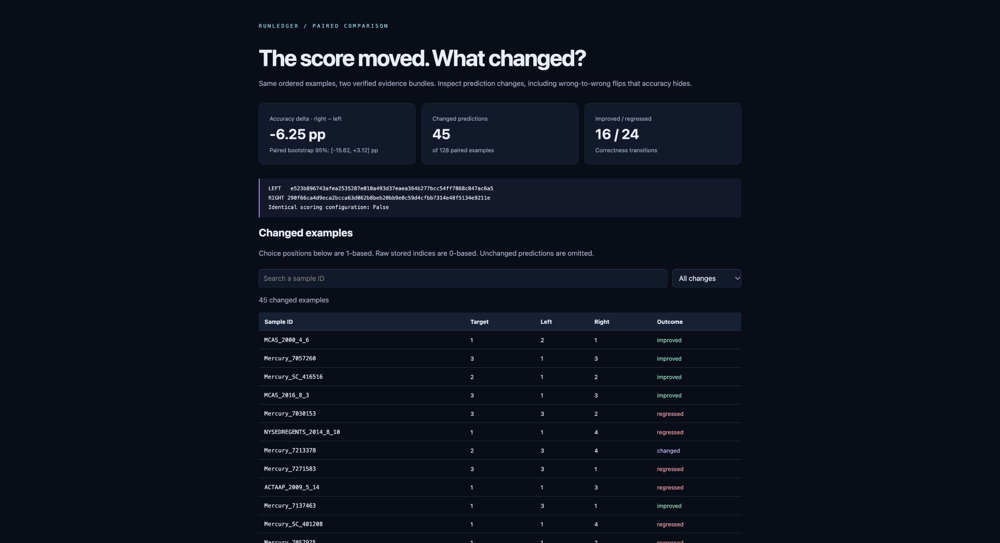

# RunLedger

**Versioned datasets, resumable LLM evaluations, and evidence you can inspect.**

An interrupted evaluation should not produce duplicate results, silently mix model versions, or leave an accuracy number without a reproducible source. RunLedger combines content-addressed Parquet datasets, a transactional job ledger, a pinned causal language-model scorer, and portable HTML evidence reports.

I wanted to explore a specific failure: **what happens when an evaluation worker dies halfway through saving its results?** RunLedger is my small testbed for making that recovery reproducible and inspectable. The included experiments use real process termination and compare the recovered results with an uninterrupted run.

This is a local, CPU-first ML infrastructure portfolio project. It uses public datasets and model weights, with no employer code or private data. It is not a distributed training framework or a claim of state-of-the-art model quality.

## Start here

- [Measured results and methodology](docs/EXPERIMENTS.md)
- [Real-model evidence dashboard](artifacts/reproduction/model/sum/index.html) — open the HTML file in a browser
- [Recovery evidence](artifacts/reproduction/failures/study.json)
- [Architecture and invariants](docs/ARCHITECTURE.md)
- [Scoring protocol](docs/SCORING.md)
- [Walkthrough and interview preparation](docs/WALKTHROUGH.md)

## Recorded results

74 passing tests; exact recovery after worker crashes at three commit boundaries; a real 128-sample LLM recovery comparison; and a four-way, 100,000-record loading study. Streaming JSONL had the lowest memory and scan time; Parquet used 4.19× less storage. [Read the raw evidence and limitations](docs/EXPERIMENTS.md).



## Try it in one minute

Requires Python 3.12 or 3.13 on macOS or Linux and [uv](https://docs.astral.sh/uv/getting-started/installation/). Install dependencies once:

```sh
git clone https://github.com/eluxsana/RunLedger.git
cd RunLedger
uv sync --locked
uv run --no-sync runledger --workspace .runledger/demo demo --output artifacts/my-demo
uv run --no-sync runledger verify-export artifacts/my-demo
```

Open `artifacts/my-demo/index.html`. The demo ingests 384 synthetic samples, starts two worker processes, kills a worker during its first result transaction, waits for its lease to expire, and completes the run. The default **hash scorer is an infrastructure fixture**, not an LLM.

Exports refuse to overwrite an existing directory. To repeat the experiment, choose a fresh workspace and output directory. No network access is needed after the core dependencies are installed.

## What is implemented

| Component | Behavior | Verification |
|---|---|---|
| Dataset versioning | Strict schemas; NFC/LF normalization; duplicate rejection; Parquet shards; source, byte and logical hashes | Round trips, corruption, invalid labels, path traversal, Unicode property tests |
| Work coordination | SQLite WAL, short write transactions, leases, heartbeats and random fencing tokens | Concurrent processes, stale workers, expiration while waiting for the lock |
| Durable results | All sample results and job completion share one transaction; unique sample and ordinal constraints | Real SIGKILL before, during and after commit; timeout and resume |
| LLM scoring | Pinned safetensors model and tokenizer; CPU float32; answer-only conditional log likelihood | Independent masked-loss calculation; batch and label invariance |
| Evidence | Immutable export with Parquet, JSON, checksums and an interactive HTML report | Recomputed DuckDB metrics, exact result digests, tampering tests |
| Comparison | Matched sample IDs and labels; paired bootstrap accuracy difference | Refuses mismatched datasets; deterministic resampling |
| Loading study | Fresh-process materialized and streaming readers for both JSONL and Parquet | Equal validation work, ordered content hashes, raw timing and RSS trials |

## Reproduce the real-model study

```sh
uv sync --locked --extra hf
uv run --no-sync python scripts/reproduce.py --hf \
  --workspace .runledger/my-study --output artifacts/my-study
```

This downloads **SmolLM2-135M** and a pinned **ARC-Easy validation** split, evaluates the first 128 rows, repeats the evaluation with a worker killed during commit, compares sum and mean answer-token scoring, and benchmarks 100,000 synthetic records. It runs entirely on CPU after downloading the public artifacts. Allow several minutes and several GB of free disk/RAM. The small model is intentional: correctness and inspectable evidence matter more here than an expensive score.

For only the process-crash experiment:

```sh
uv run --no-sync runledger --workspace .runledger/crash-proof \
  failure-study --output artifacts/my-failure-study
```

For only the loading benchmark:

```sh
uv run --no-sync runledger benchmark --rows 100000 --repeats 5 \
  --output artifacts/my-loading.json
```

The checked-in results describe one machine and one workload. They are **not** a general training-throughput, GPU-utilization, or multi-node scaling result.

## Bring a dataset

One JSON object per line; `target` is a zero-based index. [Example input](fixtures/example.jsonl):

```json
{"sample_id":"q1","prompt":"Which number is even?","choices":["three","four","five"],"target":1,"split":"test","metadata":{}}
```

```sh
uv run --no-sync runledger ingest fixtures/example.jsonl \
  --source-name "Handwritten examples" --source-uri "runledger://examples" \
  --source-license MIT
```

The command prints the dataset ID. Use that ID with `verify` or `run`; `run` prints its run ID before starting work. `--model-config` selects a downloaded, pinned HF configuration. Omitting it selects the hash fixture.

```sh
uv run --no-sync runledger run "$DATASET_ID" --workers 2
uv run --no-sync runledger inspect "$RUN_ID" --events
uv run --no-sync runledger resume "$RUN_ID"
uv run --no-sync runledger export "$RUN_ID" artifacts/my-run
uv run --no-sync runledger compare artifacts/run-a artifacts/run-b
```

Set `DATASET_ID` and `RUN_ID` to the IDs printed by your commands. `runledger --help` and `runledger COMMAND --help` describe all options. Commands emit machine-readable JSON on stdout and errors on stderr.

## Test and inspect

```sh
uv run --no-sync ruff check src tests scripts
uv run --no-sync ruff format --check src tests scripts
uv run --no-sync pytest --cov=runledger --cov-report=term-missing
uv build
```

For real-model numerical tests, set `RUNLEDGER_HF_CONFIG` to the JSON file printed by `fetch-model`, after installing the `hf` extra. These tests use local files only. Without that variable they are explicitly skipped; the ordinary test suite never downloads a model. GitHub Actions is configured for macOS/Linux and Python 3.12/3.13. Check the Actions tab for current remote results; the recorded experiment results were produced locally.

The core dependency lock and optional model dependencies are in `uv.lock`. A clean wheel-install smoke test is recorded in [the validation notes](docs/EXPERIMENTS.md).

## Boundaries worth understanding

- **At-least-once execution, unique committed results within a run.** A failed attempt may compute scores twice. The claim is not universal “exactly-once execution.”
- **Single machine, local disk.** SQLite WAL is unsuitable for a ledger shared across machines on a network filesystem. A cluster version needs a different coordinator.
- **Resume is strict.** Changes to code, runtime versions, model files, dataset bytes or scoring settings require restoring the recorded environment or starting a new run. Terminal failed jobs stay failed; inspect the cause and create a new run after fixing it.
- **No silent truncation.** Overlong sequences or ambiguous tokenizer boundaries fail the job. Accuracy is never exported from a partially successful run.
- **Hashes are integrity checks, not signatures.** They detect accidental edits relative to a receipt, not a maliciously rewritten receipt.
- **Process-crash testing is not power-loss testing.** SQLite uses FULL synchronous mode; no machine power-loss or filesystem corruption guarantee has been experimentally established.

## License and acknowledgments

RunLedger code and handwritten/synthetic fixtures are [MIT licensed](LICENSE). Model weights retain their [Apache-2.0 license](https://huggingface.co/HuggingFaceTB/SmolLM2-135M). AI2 ARC retains [CC-BY-SA-4.0 attribution and license terms](https://huggingface.co/datasets/allenai/ai2_arc); downloaded questions and weights are excluded from the source repository. See [THIRD_PARTY.md](THIRD_PARTY.md) for the pinned sources and the established tools this project builds on.

## Inspect prediction drift

A headline score can hide changed answers. Compare two verified exports and inspect improved, regressed, and wrong-to-wrong predictions in a standalone report:

```sh
runledger compare artifacts/reproduction/model/sum artifacts/reproduction/model/mean --report /tmp/drift.html
```



The included example changes the scoring normalization on the same model and dataset. It is not evidence that one model version beats another. [Methodology and limits](docs/EXPERIMENTS.md#prediction-drift-explorer).
