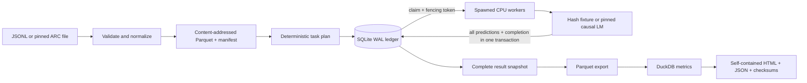
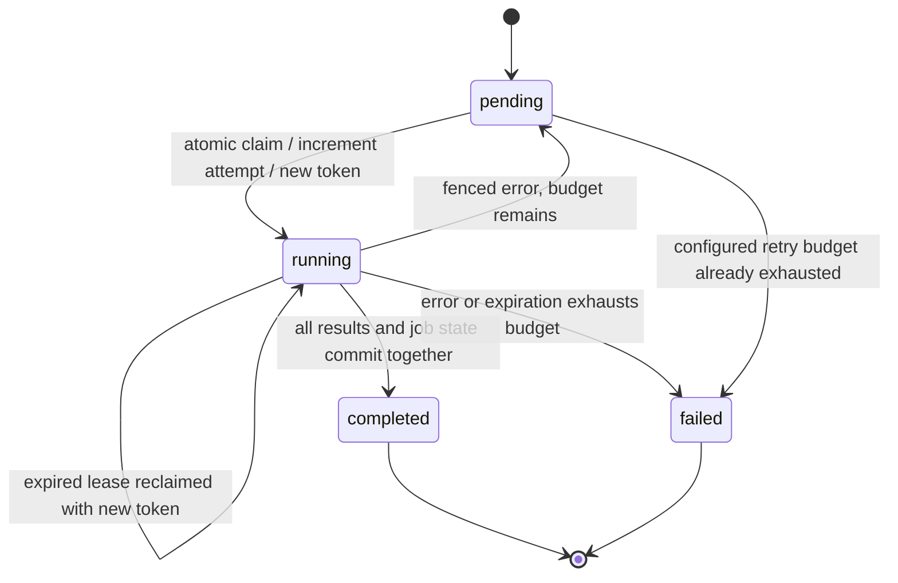

# Architecture and correctness

## Data flow

## Identity is separate from execution history

A dataset has two identifiers:

1. **Semantic SHA-256:** ordered canonical normalized records, including IDs, prompts, answer choices, labels, split and metadata. Rechunking does not change this digest.
2. **Dataset ID:** canonical manifest identity, including provenance, preprocessing, shard sizes and hashes. Rechunking or changing Parquet bytes changes this ID.

The creation timestamp is excluded from identity. The same immutable ingestion returns the existing dataset; staging happens under a unique temporary directory, published with a directory rename. Ingestion never rewrites a published version.

A run ID hashes the dataset ID, logical data digest, scoring configuration, task batch size, package source fingerprint, and runtime versions. Worker count, retry timing, process IDs and wall-clock timestamps are operational history, not model-result identity. A result digest hashes ordered canonical predictions, including all answer scores and token counts, but excludes timings and process identities.

Source hashing intentionally covers the complete Python package, including reporting code. This is conservative: a report-only source change also forces a new run. A future release could version the evaluator and reporter independently after defining a stable scorer ABI.

## Job state machine

Every mutating operation uses a short `BEGIN IMMEDIATE` transaction. The clock is read **after** taking the transaction lock. A worker that waited for a lock cannot use an earlier, stale timestamp to accept an already-expired lease.

The model forward pass and shard decoding happen outside the database transaction. A separate thread sends heartbeats approximately every lease/3. Before committing, the transaction rereads the active job, verifies status, token and expiration, and checks exact ordered sample IDs, target indices and answer counts. Prediction validation also rejects NaNs, incorrect argmax decisions and inconsistent correctness flags.

Two uniqueness constraints matter: `(run_id, sample_id)` prevents duplicate committed samples, and `(run_id, ordinal)` prevents duplicate dataset positions. Results are inserted with strict `INSERT`, never an “ignore conflicts” operation that could conceal a partially different result. Completion and all sample rows are committed together.

## Crash boundaries

| Crash point | Durable state | Recovery |
|---|---|---|
| Before commit | Running job; no result rows | Lease expires, new attempt claims the job |
| During commit, after first INSERT | SQLite rolls the uncommitted transaction back | New attempt commits the full result set |
| After commit | Completed job plus all its result rows | Job is never scheduled again |
| Supervisor timeout | Previously committed rows remain; active worker is terminated | Resume reclaims expired work under the original run specification |
| Old worker returns late | Token or expiration no longer matches | Entire stale commit is rejected |

The fault study uses SIGKILL on a real worker process. The during-commit hook executes after the first result INSERT and before transaction commit. It therefore tests the partial-write boundary rather than merely killing a worker between jobs.

The result guarantee is **unique, atomic committed results per job within a run, with at-least-once computation**. It relies on the local filesystem, SQLite transaction behavior, and an intact ledger. It does not cover network partitions, host or disk loss, Byzantine workers, multi-host clocks, or arbitrary side effects in a custom scorer.

## Why SQLite and DuckDB have different jobs

SQLite arbitrates short, durable, multi-process writes. WAL lets readers observe committed data while a writer is active, with a single writer at a time. It requires shared-memory coordination on a single host; the ledger must not live on NFS or a cross-machine shared volume. [SQLite WAL documentation](https://www.sqlite.org/wal.html).

DuckDB performs analytical queries over the immutable exported Parquet file. It does not own the live job database. This avoids using a native DuckDB file as an unsupported multi-process writer coordination service. [DuckDB concurrency documentation](https://duckdb.org/docs/current/connect/concurrency).

This tradeoff is appropriate for a laptop or one CPU host. At larger scale, replace the ledger behind the claim/heartbeat/commit interface with PostgreSQL and transaction-safe queue selection. Object storage can hold immutable shards and receipts. Do not simply put the SQLite file on shared storage.

## Bounded processing and integrity

- JSONL reads stop at a 2 MiB per-record limit instead of loading an arbitrarily large line.
- Ingestion flushes at a row limit or 16 MiB of encoded sample content. Duplicate IDs are indexed in temporary SQLite, not a Python set that grows with the corpus.
- Shard decoding reads and hashes the same byte snapshot, with a 64 MiB compressed-file limit. This closes the gap between verifying one version of a file and opening a changed version.
- Tasks stay within one Parquet row group. Task size and choice mini-batch size are separate controls.
- Workers rehash a shard when reading a task. This conservative implementation can repeatedly hash and decode the same shard or row group; it favors correctness over maximum throughput.
- HF scoring retains tokenized sequences for one task and full vocabulary logits for one choice mini-batch. Memory still depends on task size, sequence length, vocabulary and worker count. More workers duplicate the model in memory.
- Result export streams records into Parquet. The HTML embeds only the first 1,000 results; the Parquet includes every result.

The benchmark measures dataset reading separately and omits per-task integrity rechecks. Its numbers are not end-to-end evaluation throughput.

## Time and reproducibility limits

Lease expiration uses the host wall clock so persisted deadlines remain interpretable across process restarts. A wall-clock jump can affect liveness: backward jumps delay reclamation, while forward jumps can expire work early. Fencing still rejects a superseded token. There is no multi-machine clock assumption because there is only one host.

PyTorch deterministic algorithms, CPU float32, pinned assets and recorded versions reduce hidden variation. They do not establish bitwise equality across all CPU models, BLAS builds, operating systems or future runtime versions. The recorded recovery experiment uses the same machine, model configuration, task boundaries and software environment.

Only complete successful runs are exported. The exporter refuses to publish a partial accuracy denominator. Operational event/timing summaries are read after results become terminal; launching another supervisor while exporting can still add operational events. Completed prediction rows remain immutable. Use one supervisor per run when generating final timing evidence.

## Extension decisions

- **GPU execution:** add an explicit device/dtype policy, hardware receipt, memory limits and numerical tolerance tests before reporting GPU speedups.
- **Distributed workers:** use a transactional service coordinator, server time for leases, and a strategy for heartbeat failure and backpressure.
- **More datasets:** preserve original choice order and explicit answer-key mapping; version selection and normalization. Never infer labels from a convenient alphabetical assumption.
- **Training data:** introduce leakage checks, deduplication policy and split auditing before extending this multiple-choice evaluation schema into a training pipeline.
- **Large results:** keep the bounded HTML preview, query the complete Parquet, and add paged data access only when needed.

These are design boundaries, not features claimed by this release.

The evidence exporter streams prediction rows, but job/event metadata and paired comparisons currently materialize their inputs. This is acceptable for the measured workload; it is a known boundary before scaling to very large run histories.
